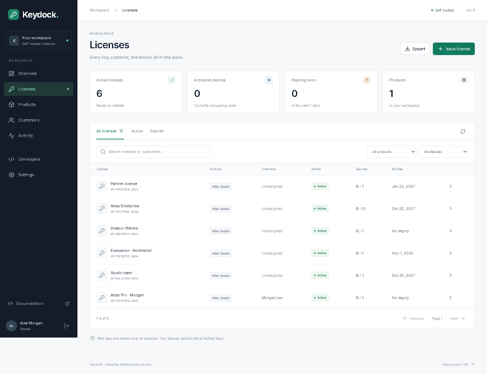

# Keydock

**Licensing infrastructure you own.** An MIT-licensed, self-hosted key system for software developers and tool owners.

Keydock includes a responsive admin console, licensing API, and JavaScript/Python clients. This is an early release; it has not undergone an independent security audit.



_The console connected to a real local instance with illustrative customer and license records._

## Available now

- A responsive console with guided owner setup, overview, licenses, products, customers, activity, developer integration and team settings.
- Products, customers and batch license issuance (up to 100 keys per request).
- 192-bit random license keys, HMAC-hashed storage, rotation, suspension, permanent revocation and renewal.
- Device limits enforced inside SQLite write transactions; idempotent activation and device release.
- Fixed expiry, lifetime licenses, or durations that begin on first activation.
- Entitlements and Ed25519-signed, device-bound offline leases.
- Owner, operator and viewer roles; expiring API tokens with optional product scope.
- Password hashing with scrypt, persistent login throttling, server-side sessions, CSRF protection and strict security headers.
- Search, pagination, safe CSV export, validation aggregates and a chained HMAC audit log.
- Optional idempotency keys for batch issuance, with encrypted response replay for 24 hours.
- Online SQLite backups with identity preservation, checksum/integrity verification, and restore into a new directory.
- An isolated local demo with sample products, customers, licenses and devices.
- [JavaScript/TypeScript client](sdk/javascript/README.md) and [Python client](sdk/python/README.md) that verify signatures, application/device binding and expiry before granting entitlements.

## Run Keydock

Requires Node.js 24.12 or newer within Node 24.

```sh
npm ci
npm run build
npm start
```

Open `http://127.0.0.1:3400`. First startup creates `data/identity.json` and `data/keydock.sqlite`. Keep both private. Copy `setupToken` from the identity file into the one-time setup screen, then create your owner account. The token is never printed in application logs. Create a product, issue a key, and use the Developers page to connect your application.

`KEYDOCK_ORIGIN` sets the exact browser origin and lease issuer. Remote deployments require HTTPS. `HOST`, `PORT` and `KEYDOCK_DATA_DIR` configure the listener and storage. Bind the listener behind a trusted TLS reverse proxy; proxy headers are deliberately not trusted by the application.

To explore a populated workspace, run `npm run demo` after building. It listens at `http://127.0.0.1:3401`, creates a random owner password, and prints the path to a private credentials file. Production environment settings are ignored. Ctrl+C closes the demo and removes its temporary data. Use `npm run demo -- --port 3402` to choose another local port.

Create a backup with `npm run backup`, check it with `npm run backup:verify -- BACKUP_DIRECTORY`, and restore it with `npm run restore -- BACKUP_DIRECTORY --to NEW_DATA_DIRECTORY`. The restore destination must not exist and its parent must already exist. Backups contain private identity material; see [storage and recovery](docs/operations.md#storage-and-recovery) for configuration and recovery steps.

## API

All routes use `/api/v1`. POST and PATCH bodies are JSON. Errors use `{ "error": { "code", "message", "requestId" } }`. Admin cookie requests require an exact `Origin` header and the `X-Keydock-CSRF` value from the session response. Integrations use `Authorization: Bearer kd_api_…`.

| Route                             | Purpose                                                                                                           |
| --------------------------------- | ----------------------------------------------------------------------------------------------------------------- |
| `POST /auth/setup`                | One-time owner setup with name, email, password (14+ characters), setupToken                                      |
| `POST /auth/login`                | Start a 12-hour session                                                                                           |
| `GET /auth/session`               | Current user and CSRF token                                                                                       |
| `POST /admin/products`            | Create a product with name and slug                                                                               |
| `POST /admin/customers`           | Create a customer with name and email                                                                             |
| `POST /admin/licenses`            | Issue keys with productId, label, maxDevices, optional customerId, expiresAt or durationDays, entitlements, count |
| `GET /admin/licenses`             | Search, filter and paginate licenses                                                                              |
| `POST /admin/licenses/:id/status` | Suspend, resume or permanently revoke                                                                             |
| `POST /admin/licenses/:id/renew`  | Extend expiry by days                                                                                             |
| `POST /admin/licenses/:id/rotate` | Replace the key; show the replacement once                                                                        |
| `POST /client/activate`           | Activate using productId, key, fingerprint, name                                                                  |
| `POST /client/validate`           | Refresh a lease for an existing activation                                                                        |
| `POST /client/deactivate`         | Release the caller's device                                                                                       |
| `GET /admin/audit/verify`         | Verify the retained audit chain                                                                                   |

Admin creation returns raw license keys once. List endpoints never return them. An `Idempotency-Key` of 16–128 letters, digits, underscores or hyphens replays the same issuance response for 24 hours. Reusing it with a different request returns 409. Retries outside that period can create new licenses.

Offline leases remain valid until their signed expiry, even after online revocation, device release, key rotation or product disablement. Choose a lease duration matching your revocation tolerance (default one hour, maximum seven days). Pin your instance public key in the client and verify issuer, product, device, signature and expiry. Offline checks require a trustworthy clock. Client-side enforcement can be patched by someone controlling the client; enforce valuable server-side operations on a trusted server.

The audit chain detects changes to retained records using the instance secret. Detecting deletion of the end of the log requires an externally retained checkpoint. A host administrator with the identity file controls the instance's trust.

## Development

```sh
npm test
npm run typecheck
npm run build
node scripts/ui-smoke.mjs
```

Tests cover concurrent device allocation, lifecycle transitions, signed lease tampering, expiry, CSRF, role and product boundaries, key rotation, encrypted idempotency replay, session invalidation, live backup recovery, damaged backup rejection, and demo isolation. The browser check runs headlessly, exercises the complete setup-to-device-release workflow, and checks mobile layout and browser errors. Install Chromium with `npx playwright install chromium` on Linux; Windows uses Edge when available. See [operations](docs/operations.md) for deployment details.

## References and attribution

Original application code is MIT licensed. Runtime dependencies retain their own licenses. Design and security decisions were informed by [OWASP password storage guidance](https://cheatsheetseries.owasp.org/cheatsheets/Password_Storage_Cheat_Sheet.html), [OWASP CSRF guidance](https://cheatsheetseries.owasp.org/cheatsheets/Cross-Site_Request_Forgery_Prevention_Cheat_Sheet.html), [Node.js SQLite documentation](https://nodejs.org/api/sqlite.html) and [Keygen's public licensing API documentation](https://keygen.sh/docs/api/licenses/). No Keygen implementation code is included.
